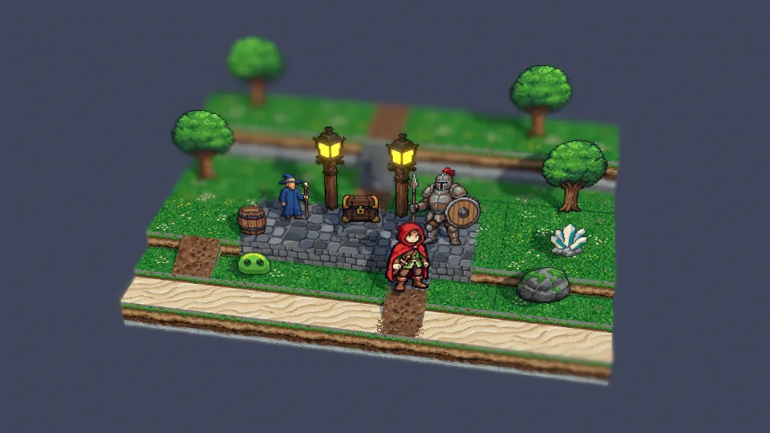

# Eightfold Path

WebGPU effects in the HD-2D style: pixel-art sprites and tiles lit like a modern 3D scene, seen
through a tilt-shift lens, with bloom, light shafts, weather and battle effects. A research gallery
in the same family as [Fire Temple](https://github.com/s4njee/firetemple) and
[Water Temple](https://github.com/s4njee/watertemple), and part of the
[holofx](https://github.com/s4njee/holofx) collection.

Every effect gets a live demo, readable source, a write-up and a practicality scorecard. The plan
is in [plan.md](plan.md). Epics 1 to 3 are done (the foundation, the research UI and the pixel-art
building blocks), and so are M0, the vertical slice (a hand-written scene format, a tile extruder,
a camera rig, a tilt-shift lens and a parallax header), and M1, the drop-in set: shaped bokeh, rack
focus, bloom tuned for pixel art, colour grading and finishing, and the web components (a hero
diorama, a pointer-lit avatar, a pixelate-on-hover image, an accessible dialogue box and menu
windows). The one item left from M0 is story 1.4's test through HoloGPU's `createEffect`, which
waits on that package being published.



## Run it

Node 22.12 or later.

```sh
npm install
npm run dev          # the gallery at http://localhost:5173
npm test             # every effect on Dawn's headless WebGPU, plus unit tests
npm run build        # typecheck, asset check, bundle, bundle check
npm run build:lib    # the publishable library in lib/ and types/
```

## Use an effect

```ts
import { createGpuSession, mount } from '@mk7s/eightfoldpath';
import { effect as hello } from '@mk7s/eightfoldpath/effects/hello';

const session = await createGpuSession();
const host = mount(session, document.querySelector('canvas')!, hello);
// later: host.destroy();
```

The package is not on npm yet. Its art is inlined into each effect's module, so nothing needs to
be served separately.

## Art

The test art is AI-generated and cleaned up into real pixel art:

- [art.md](art.md) lists what the experiments need and [prompts.md](prompts.md) the prompts.
- `npm run meshy` generates through the Meshy API (it needs `MESHY_API_KEY` in a git-ignored `.env`).
  The raw output in `art/` stays out of git.
- `npm run assets:clean` detects each image's pixel grid, samples one colour per cell, keys out the
  background, derives a shared 48-colour palette and writes `assets/` with a manifest.
- `npm run assets:check` (part of `build`) fails on an unlisted file, a wrong size, a colour
  outside the palette, partial transparency, or a Meshy image that lost its AI-generation metadata.

The art was generated on a paid Meshy plan and is MIT licensed with the rest of the repository; Meshy's
AI-generation metadata is kept in every image. See [CREDITS.md](CREDITS.md).

## Layout

```
assets/          cleaned art, the palette, hand-written scenes (scenes/) and manifest.json
src/effects/     one directory per effect: meta.ts, index.ts, *.wgsl, notes.md, poster.webp
src/gpu/         re-exports of @mk7s/hologpu-temple-core, plus assets.ts (image loading, texture arrays),
                 sprites/ (the batcher), diorama/ (scenes, terrain, camera rig, lit stage) and lens/
                 (tilt-shift, bokeh, rack focus, layer depth of field, light shafts), post-fx/ (pixel
                 bloom, grading, finishing) and ui/ (DOM overlays)
src/shell/       the gallery, copied from Fire Temple
src/lib/         the library entry: createEffectHost and mount
tests/           Vitest on Dawn's Node bindings: real WebGPU, no browser
docs/            the support-matrix delta, the write-up template and the cost studies (studies/)
```
